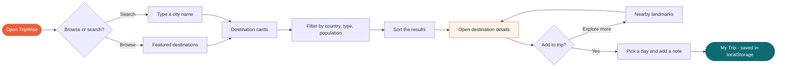
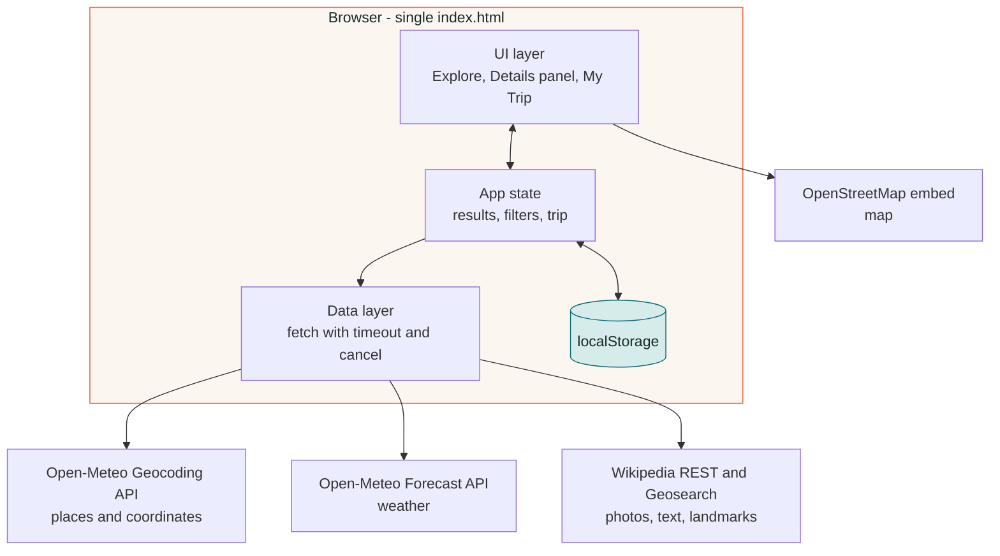
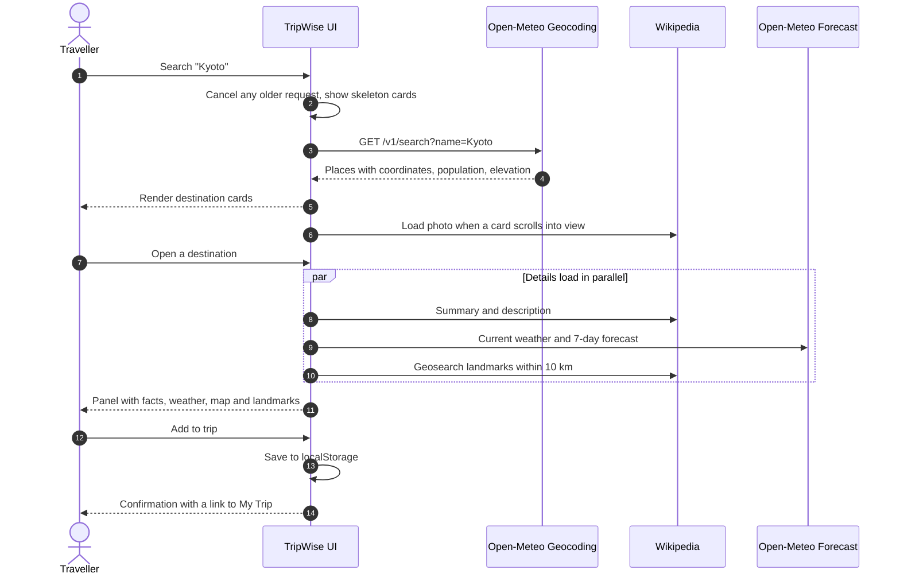
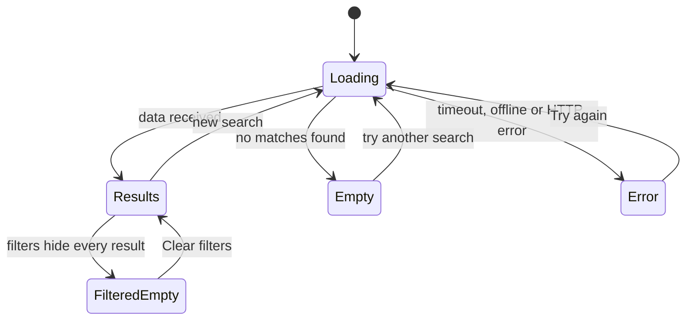

<p align="center">
  
</p>

<p align="center">
  <a href="https://shrutilayau-24.github.io/TripWise/">
    
  </a>
</p>

<p align="center">
  <a href="https://shrutilayau-24.github.io/TripWise/"></a>
  <a href="https://github.com/shrutilayau-24/TripWise"></a>
</p>

<p align="center">
  
  
  
  
  
  
  
</p>

<p align="center">
  <b>Search any city on Earth, check the live forecast, discover nearby landmarks<br>and build a day-by-day itinerary, all in one place.</b>
</p>

---

## Table of contents

- [Overview](#overview)
- [Requirement checklist](#requirement-checklist)
- [Features](#features)
- [How it works](#how-it-works)
- [Tech stack](#tech-stack)
- [APIs used](#apis-used)
- [Reliability and error handling](#reliability-and-error-handling)
- [Data storage](#data-storage)
- [Getting started](#getting-started)
- [Project structure](#project-structure)
- [Credits](#credits)

---

## Overview

Planning a trip usually means juggling many websites for places, weather and notes. **TripWise** brings that into one fast, single-page app. You search for a destination, open it to see its description, facts, 7-day weather, map and nearby landmarks, then add it to a personal itinerary that you can organise by day and keep across visits.

It is built as a **single `index.html`** with vanilla HTML, CSS and JavaScript. There is no build step, no backend and no API key, so anyone can clone and run it in seconds.

> **Track chosen:** Frontend Development. A separate backend or database is optional for this track, so the itinerary is saved in browser storage.

---

## Requirement checklist

Every mandatory item from the task brief, and where it lives in the app.

| # | Requirement (Frontend track) | Status | Implementation |
|---|---|:---:|---|
| 1 | Fetch data from at least one real external API | ✅ | Open-Meteo Geocoding and Forecast, Wikipedia REST and Geosearch |
| 2 | Display destinations in a clear card layout | ✅ | Responsive card grid with photo, location, type and key facts |
| 3 | Search destinations | ✅ | Live city search across the world |
| 4 | Filters | ✅ | Country, type and population |
| 5 | At least one sorting option | ✅ | Relevance, population, name A to Z, elevation |
| 6 | Destination details with add-to-itinerary | ✅ | Slide-in details panel with an **Add to trip** button |
| 7 | Add, view and remove itinerary items | ✅ | **My Trip** view with day planner, notes and undo |
| 8 | Itinerary persists after refresh | ✅ | Saved in `localStorage` |
| 9 | Responsive on desktop and mobile | ✅ | Fluid grid, bottom-sheet details on phones |
| 10 | Loading, error and empty states | ✅ | Skeleton loaders, retry buttons, empty and no-match views |

---

## Features

<table>
<tr>
<td width="50%" valign="top">

### 🔎 Explore
- Featured destinations on first load
- Search any city worldwide
- Filter by country, type and population
- Sort by relevance, population, name or elevation
- Photos load lazily as cards scroll into view

</td>
<td width="50%" valign="top">

### 📍 Destination details
- Description from Wikipedia
- Quick facts: type, country, coordinates, population, elevation, time zone
- Current weather and 7-day forecast with a °C / °F switch
- Embedded OpenStreetMap
- Landmarks within 10 km, each addable to your trip

</td>
</tr>
<tr>
<td width="50%" valign="top">

### 🧳 My Trip
- Add cities and landmarks
- Assign each stop to Day 1 to 10 or leave it unplanned
- Add a note per stop and rename the trip
- Live stats: stops, countries, scheduled
- Copy as text, print, remove with undo, clear all

</td>
<td width="50%" valign="top">

### ✨ Experience
- Warm editorial design with smooth motion
- Dark mode (follows your system, toggle anytime)
- Keyboard shortcut `/` focuses search, `Esc` closes details
- Accessible labels, focus styles and reduced-motion support
- Print-friendly itinerary

</td>
</tr>
</table>

---

## How it works

### 1. User journey



### 2. Architecture

Everything runs in the browser. The data layer talks to public APIs, and the trip is stored locally.



### 3. Search and details, step by step



### 4. Interface states

Every screen handles the four situations a real user can hit.



---

## Tech stack

| Layer | Choice |
|---|---|
| Markup | HTML5, semantic landmarks and ARIA labels |
| Styling | CSS3 with custom properties, grid, flexbox and keyframe animation |
| Logic | Vanilla JavaScript (ES2020), `fetch`, `AbortController`, `IntersectionObserver` |
| Fonts | Fraunces and Plus Jakarta Sans via Google Fonts |
| Storage | Browser `localStorage` |
| Hosting | GitHub Pages |
| Build tools and frameworks | None |

## APIs used

All APIs are free and need **no API key**, so no credentials exist anywhere in this repository.

| API | Used for |
|---|---|
| [Open-Meteo Geocoding](https://open-meteo.com/en/docs/geocoding-api) | Destination search and place data: name, country, coordinates, population, elevation, time zone |
| [Open-Meteo Forecast](https://open-meteo.com/en/docs) | Current weather and 7-day forecast |
| [Wikipedia REST API](https://en.wikipedia.org/api/rest_v1/) | Photos and descriptions |
| [Wikipedia Action API (geosearch)](https://www.mediawiki.org/wiki/API:Geosearch) | Landmarks within 10 km of a destination |
| [OpenStreetMap embed](https://www.openstreetmap.org/) | Map in the details panel |

<details>
<summary><b>Endpoints and example calls</b></summary>

```text
Search places
GET https://geocoding-api.open-meteo.com/v1/search?name=Kyoto&count=50&language=en&format=json

Weather
GET https://api.open-meteo.com/v1/forecast?latitude=35.01&longitude=135.77
    &current=temperature_2m,relative_humidity_2m,wind_speed_10m,weather_code
    &daily=weather_code,temperature_2m_max,temperature_2m_min
    &timezone=auto&forecast_days=7

Description and photo
GET https://en.wikipedia.org/api/rest_v1/page/summary/Kyoto

Nearby landmarks
GET https://en.wikipedia.org/w/api.php?action=query&generator=geosearch
    &ggscoord=35.01|135.77&ggsradius=10000&ggslimit=14&format=json&origin=*
```

</details>

> **Limits and attribution:** Open-Meteo's free tier is for non-commercial use with fair-use limits, and its data is licensed CC BY 4.0. Wikipedia text is CC BY-SA. Map data is © OpenStreetMap contributors. All credits also appear in the app footer.

---

## Reliability and error handling

| Situation | What the user sees |
|---|---|
| Data is loading | Shimmering skeleton cards |
| Nothing matches the search | "No destinations found" with suggested cities to try |
| Filters hide every result | "No matches for these filters" with a **Clear filters** button |
| Network is offline | A clear offline message with **Try again**, and an automatic retry when the connection returns |
| API is slow | Requests time out after 12 seconds with a helpful message |
| API returns an error | A message that includes the status, with **Try again** |
| Weather or landmarks fail | Only that section shows an error with its own **Retry**, the rest of the panel still works |
| Search typed too short | A friendly prompt to type at least 2 characters |
| Photo is missing | A coloured gradient with the place's initial |

Extra safeguards:

- **Cancel stale requests:** starting a new search cancels the previous one, so old results can never overwrite new ones.
- **Photo accuracy:** a Wikipedia match more than 120 km from the destination is rejected, which avoids showing the wrong city's picture.
- **Undo:** removing a stop or clearing the trip can be undone.
- **Safe rendering:** all API text is escaped before it is inserted into the page.

## Data storage

There is no backend or database for the Frontend track. Everything is stored in the browser's `localStorage`, so the itinerary stays after a refresh.

| Key | Contents |
|---|---|
| `tripwise.trip.v1` | Trip name and the list of itinerary items |
| `tripwise.theme` | Light or dark theme |
| `tripwise.unitF` | Temperature unit preference |

<details>
<summary><b>Itinerary item shape</b></summary>

```json
{
  "id": "g1857910",
  "kind": "city",
  "name": "Kyoto",
  "admin1": "Kyoto",
  "country": "Japan",
  "lat": 35.02107,
  "lon": 135.75385,
  "category": "Regional capital",
  "img": "https://upload.wikimedia.org/...",
  "desc": "Short description from Wikipedia",
  "day": 2,
  "note": "Book the tea ceremony",
  "added": 1792293836776
}
```

`kind` is `city` or `attraction`, and `day` is `0` for unplanned or `1` to `10`.

</details>

---

## Getting started

No installation is needed.

```bash
# 1. Clone the repository
git clone https://github.com/shrutilayau-24/TripWise.git
cd TripWise

# 2. Open index.html in a modern browser
#    or serve it locally:
python -m http.server 8000
# then visit http://localhost:8000
```

An internet connection is required to load destination data.

**Deployment:** the site is hosted on GitHub Pages from the `main` branch (root folder).
Live at **https://shrutilayau-24.github.io/TripWise/**

## Project structure

```text
TripWise/
├── index.html   # markup, styles and scripts in a single file
└── README.md    # this document
```

Inside `index.html`, the script is organised into: helpers, data layer (API calls), trip state, Explore view, details panel, trip view, and routing and theme.

## Credits

- Destination and weather data by [Open-Meteo](https://open-meteo.com/) (CC BY 4.0)
- Descriptions and photos from [Wikipedia](https://www.wikipedia.org/) contributors (CC BY-SA)
- Maps © [OpenStreetMap](https://www.openstreetmap.org/copyright) contributors
- Fonts by [Google Fonts](https://fonts.google.com/): Fraunces and Plus Jakarta Sans
- README banner by [capsule-render](https://github.com/kyechan99/capsule-render) and typing animation by [readme-typing-svg](https://github.com/DenverCoder1/readme-typing-svg)

---

<p align="center">
  Built by <b>SHRUTILAYA U</b> (<code>26BCE1766.</code>) for the <b>AWS Student Builder Group, VIT Chennai</b> Web Development Recruitment Task.<br>
  <sub>Plan the trip. Keep the wonder. ✈</sub>
</p>


